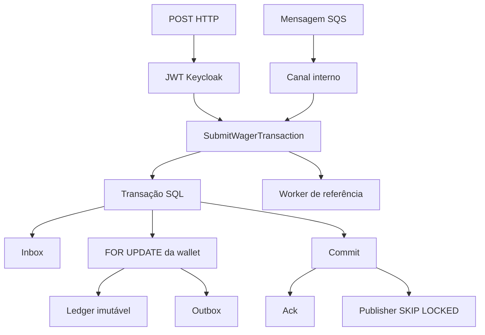

# Arquitetura

Processador de apostas com uma regra de ouro: o PostgreSQL confirma saldo, ledger, inbox e outbox na mesma transação, ou não confirma nada. SQS entrega at-least-once e pode reordenar. Várias instâncias podem tocar a mesma wallet. A correção não depende de cache em memória nem de fila FIFO.

Estado atual (ver [docs/ROADMAP.md](docs/ROADMAP.md)): borda (Compose, health, Keycloak), domínio financeiro completo com testes unitários e schema PostgreSQL com as invariantes provadas em banco real. Casos de uso HTTP, consumidor SQS e publisher da outbox ainda não existem.

## Fluxo



A entrada HTTP e a entrada da fila chamam o mesmo caso de uso. A diferença é a borda:

- HTTP exige Bearer JWT. O claim `provider_id` tem de ser o mesmo `providerId` do corpo. Quem compara é o caso de uso (`assertSameProvider`), não um `if` solto no controller.
- A fila é canal interno. Não há assinatura na mensagem nesta versão. O `providerId` do payload continua passando pela validação de domínio: existe, cabe na operação, e a referência resolvida pertence a esse provedor.

Ack da mensagem só depois do commit. Se o processo morre no meio, a transação SQL desfaz. Se morre depois do commit e antes do ack, a reentrega encontra a inbox ou a idempotency key e não aplica o efeito de novo.

Evento de integração só é inserido na outbox dentro dessa mesma transação. Publicar antes do commit está fora do desenho.

## Dinheiro

`Money` é imutável. Cada operação devolve outra instância. Por dentro, o valor é um `bigint` de centavos, escala fixa 2. A borda HTTP, a fila e o `data` dos eventos falam só isto:

```json
{ "amount": "25.00", "currency": "BRL" }
```

O domínio não importa tipo monetário do MikroORM nem decorator do Nest. `number`, `float` e `double` não entram em conta.

Regras de entrada: rejeitar vazio, `NaN`, `Infinity`, notação científica, mais de duas casas, sinal negativo nos contratos de entrada e moeda que não seja ISO-4217 de três letras. Moedas diferentes lançam erro de domínio. A operação do dia é BRL; o tipo continua multi-moeda para o conflito ser testável.

No Postgres a coluna é `numeric(19,2)`. O driver devolve string. A reidratação converte para centavos. `numeric` é exato; a string na borda evita o `number` do JavaScript.

## Modelo

Construtor `private` ou `protected`. Criação por `create`, `from` ou `open`. O que sai do banco volta por `rehydrate`, que reconstrói estado já persistido e não reaplica regra de transição.

### Wallet

No máximo uma wallet por `(playerId, currency)`. Saldo nunca negativo. Toda mudança de saldo tem um lançamento, e todo lançamento explica uma mudança. `version` nasce em 1 e só aumenta quando o saldo muda. LOSS não mexe em saldo, não gera ledger e não incrementa versão.

`POST /wallets` com saldo inicial maior que zero grava, na mesma transação, a wallet, uma `WagerTransaction` `OPENING` e um crédito no ledger. Saldo inicial zero: wallet versão 1 e ledger vazio. `OPENING` não entra pela API de aposta nem pela fila.

### WagerTransaction

| Kind | Saldo | Ledger | Regra |
| --- | --- | --- | --- |
| BET | débito | um DEBIT | rejeita se não há saldo |
| WIN | crédito | um CREDIT | pode apontar para a BET da mesma rodada |
| LOSS | nenhum | nenhum | registra o resultado |
| REFUND | crédito | um CREDIT | reverte uma BET `PROCESSED`, uma vez, valor igual |
| ROLLBACK | inverso da referência | uma entrada invertida | reverte BET, WIN ou REFUND `PROCESSED`, uma vez, valor igual |

REFUND e ROLLBACK exigem `referenceExternalTransactionId`. A referência é `(providerId, referenceExternalTransactionId)` e tem de ser o mesmo provedor, player, wallet, moeda e rodada. WIN (e LOSS) com referência segue o mesmo escopo e só pode apontar para BET; sem referência, o crédito vale sozinho. A referência precisa estar `PROCESSED`: se ainda está pendente, a operação espera como `PENDING_REFERENCE`; se terminou `REJECTED`/`FAILED`, a operação é rejeitada com `REFERENCE_NOT_PROCESSED`.

**Interpretação adotada — uma reversão por referência, de qualquer tipo.** O enunciado proíbe reverter duas vezes "pelo mesmo tipo". Adotamos a regra mais estrita: uma transação aceita no máximo **uma** reversão `PROCESSED`, seja REFUND ou ROLLBACK. Sem isso, REFUND + ROLLBACK da mesma BET creditaria o jogador duas vezes. Desfazer um REFUND continua possível com ROLLBACK do próprio REFUND (outra referência). No banco: índice único parcial em `reference_transaction_id` para `status = 'PROCESSED' and kind in ('REFUND','ROLLBACK')`.

O processamento é um serviço de domínio puro (`processWager`) que recebe a wallet já travada, a referência resolvida e o fato de ela já ter sido revertida, e devolve `PROCESSED` (com o lançamento), `REJECTED` (com failure code) ou `PENDING_REFERENCE`. A ordem das checagens é: moeda → player → referência (existência, status, escopo, kind, valor, já revertida) → saldo.

Uma reversão que deixaria o saldo negativo é `REVERSAL_WOULD_GO_NEGATIVE`, diferente de `INSUFFICIENT_FUNDS`. Os dois ficam auditáveis. Reversão parcial não existe.

Status `PROCESSED`, `REJECTED` e `FAILED` são terminais. Transição a partir deles é erro de programação (`InvalidTransactionStateError`), não um ramo de negócio.

Transições aceitas:

- `PENDING` → `PROCESSED` | `PENDING_REFERENCE` | `REJECTED` | `FAILED`
- `PENDING_REFERENCE` → `PROCESSED` | `REJECTED` | `FAILED`

`REJECTED` não altera saldo e não gera ledger. Repetir uma operação já terminada devolve o resultado original, inclusive o saldo observado naquele momento. Esse saldo é gravado na transação no commit. Não se relê o saldo atual da wallet para montar o replay.

A mesma idempotency key com outro payload é conflito. Não é replay e não cria segunda linha.

### Ledger

`WalletLedgerEntry` não tem campo mutável nem método de transição (todos `readonly`, objeto congelado). `create` exige `balanceBefore ± money = balanceAfter`, valor positivo e saldos não negativos. Cada lançamento carrega `walletVersion` (a versão da wallet depois dele): a abertura é a versão 1, cada movimento seguinte é +1. No máximo um lançamento por transação e por wallet. Update, delete e truncate são recusados por trigger.

### Inbox e outbox

`InboxMessage`, a mudança financeira, o ledger e a `OutboxMessage` entram na mesma transação SQL quando a origem é a fila. Na origem HTTP não há inbox; o restante continua atômico.

A outbox guarda o envelope já serializado (`toJSON` do evento). `Money` no `data` é `MoneyProps`, nunca a instância.

Eventos mínimos:

| Evento | Quando |
| --- | --- |
| `WagerTransactionProcessed` | aplicada, inclusive LOSS |
| `WagerTransactionRejected` | rejeitada por regra de negócio |
| `WalletBalanceChanged` | só quando o saldo muda |
| `WagerTransactionPendingReference` | referência ainda não existe |

## Idempotência

O header `Idempotency-Key` é a fonte da verdade. O default recomendado ao cliente é `{providerId}:{externalTransactionId}`. O servidor não recompõe a chave se o header vier preenchido, e recusa a requisição se o header faltar.

`payloadHash` é SHA-256 em hexadecimal de um JSON canônico:

1. Só entram campos de negócio: `providerId`, `externalTransactionId`, `playerId`, `walletId`, `roundId`, `gameId`, `kind`, `money` (`amount`, `currency`) e, se presente, `referenceExternalTransactionId`.
2. Chaves ordenadas em todo objeto. Sem espaços. Campo ausente fica de fora; não se grava `null` no lugar.
3. Header, `messageId` e o restante do transporte ficam de fora.

Inbox única em `(consumer_name, message_id)`. Deduplicação e FIFO do SQS encurtam reentrega; não substituem essas restrições.

## Concorrência

A unidade de lock é a linha da wallet. Dentro da transação SQL: `SELECT … FOR UPDATE` dessa linha, aplica a regra, grava ledger e outbox, incrementa `version` se o saldo mudou. Duas wallets seguem em paralelo. Não há lock global.

O `UPDATE` do saldo também exige a `version` lida no lock. Se algum caminho esquecer o `FOR UPDATE`, a segunda escrita não passa. O lock pessimista é a estratégia principal, porque a wallet quente (duas apostas de 80.00 sobre 100.00) precisa serializar sem tempestade de retry. A versão é a segunda trava e o número que a API devolve.

O banco ainda segura o que o lock não endereça. Tudo abaixo está na migration `Migration20261113000000_initial_schema` e tem teste em `test/integration/schema.test.ts`:

| Invariante | Mecanismo no PostgreSQL |
| --- | --- |
| uma wallet por player + moeda | `UNIQUE (player_id, currency)` |
| saldo nunca negativo | `CHECK (balance_amount >= 0)` em wallets e `balance_before/after >= 0` no ledger |
| idempotência persistente | `UNIQUE (idempotency_key)` e `UNIQUE (provider_id, external_transaction_id)` |
| ledger imutável | triggers recusam `UPDATE`, `DELETE` e `TRUNCATE` |
| aritmética de cada lançamento | `CHECK` `balance_after = balance_before ± amount`, `amount > 0` |
| um lançamento por transação | `UNIQUE (transaction_id)` e `UNIQUE (wallet_id, transaction_id)` |
| lançamento coerente com a transação | FK composta `(transaction_id, wallet_id, amount, currency)` → `wager_transactions`; FK `(wallet_id, currency)` → `wallets` |
| ledger encadeado, sem bifurcação | `UNIQUE (wallet_id, wallet_version)` + trigger: `balance_before` = `balance_after` da versão anterior |
| saldo materializado = ledger | constraint trigger **diferida** em `wallets`: no commit, existe lançamento com `wallet_version = version` e `balance_after = balance_amount` (ou wallet zerada na versão 1 sem lançamentos) |
| uma reversão processada por referência | índice único parcial em `reference_transaction_id` |
| REFUND/ROLLBACK com referência | `CHECK` |
| OPENING é interno | `CHECK ((kind = 'OPENING') = (provider_id = 'internal'))` |
| estados terminais imutáveis | trigger recusa qualquer `UPDATE` em linha `PROCESSED/REJECTED/FAILED`, mudança de campo de negócio e `DELETE` |
| consistência de status | `CHECK`s: `failure_code` sse `REJECTED/FAILED`; `completed_at` sse terminal; `PROCESSED` tem saldo resultante; `PENDING_REFERENCE` tem próxima tentativa |
| inbox única | `PRIMARY KEY (consumer_name, message_id)` |
| outbox íntegra | `CHECK` de `payload.eventId = id`; trigger torna o evento imutável e `published_at` definitivo |

A constraint trigger diferida é o que fecha "toda alteração de saldo tem lançamento (e vice-versa)" no banco, não só no código: um `UPDATE wallets` sem lançamento correspondente aborta o commit inteiro.

Cenário obrigatório: saldo 100.00 BRL, duas apostas simultâneas de 80.00. Uma fica `PROCESSED`, a outra `REJECTED` com `INSUFFICIENT_FUNDS`, saldo final 20.00, um débito no ledger. Retry não cria outro débito.

## Referência fora de ordem

Se a referência não existe, a transação persiste como `PENDING_REFERENCE` e a resposta HTTP é 202. Um worker reprocessa com backoff exponencial a partir de 1s, dobrando até o teto de 60s.

Limite: 8 tentativas ou 15 minutos desde `createdAt`, o que ocorrer primeiro. O teto cabe numa rodada de jogo que ainda pode chegar atrasada, e não deixa linha pendente a noite inteira. Esgotou o limite: `REJECTED`, `REFERENCE_NOT_FOUND`, evento `WagerTransactionRejected`.

## Failure codes

Estáveis, em `SCREAMING_SNAKE`, para o provedor decidir se reenvia, corrige o payload ou desiste.

Rejeições persistidas (`status = REJECTED`, HTTP 422, evento `WagerTransactionRejected`):

| Código | Significado | O provedor |
| --- | --- | --- |
| `INSUFFICIENT_FUNDS` | BET sem saldo | não reenvia igual |
| `REVERSAL_WOULD_GO_NEGATIVE` | ROLLBACK de WIN/REFUND deixaria saldo negativo | não reenvia igual |
| `CURRENCY_MISMATCH` | moeda da operação diferente da wallet | corrige o payload |
| `PLAYER_WALLET_MISMATCH` | `playerId` não é o dono da wallet | corrige o payload |
| `REFERENCE_NOT_FOUND` | referência não chegou dentro do limite | desiste ou investiga |
| `REFERENCE_NOT_PROCESSED` | a referência existe, mas terminou `REJECTED`/`FAILED` | desiste |
| `REFERENCE_KIND_NOT_ALLOWED` | REFUND/WIN/LOSS fora de BET, ou ROLLBACK fora de BET, WIN e REFUND | corrige o payload |
| `REFERENCE_SCOPE_MISMATCH` | referência de outro player, wallet, moeda ou rodada | corrige o payload |
| `AMOUNT_MISMATCH` | valor diferente do da referência | corrige o payload |
| `ALREADY_REVERSED` | a referência já tem uma reversão `PROCESSED` | não reenvia como operação nova |

Erros de contrato, que não viram linha (HTTP 400, ou 404 para wallet): `INVALID_MONEY`, `INVALID_FIELD`, `INVALID_KIND`, `REFERENCE_REQUIRED`, `INVALID_REFERENCE` (autorreferência), `OPENING_NOT_SUBMITTABLE`, `WALLET_NOT_FOUND`. Não são persistidos porque o payload não descreve uma operação válida — não há o que auditar além do log.

`FAILED` usa `PERMANENT_PROCESSING_ERROR` para erro permanente de infraestrutura (mensagem que nunca poderá ser aplicada).

Conflito de idempotência (mesma chave, outro hash) não é failure code de transação: a segunda requisição não vira linha. A resposta é 409.

`FAILED` fica reservado para erro permanente de infraestrutura, com código próprio quando a fase de mensageria precisar distinguir poison message de rejeição de negócio. Rejeição de regra continua `REJECTED`.

## HTTP

O mesmo mapa vale para todos os endpoints. O provedor não precisa ler a mensagem para saber se pode reenviar.

| Situação | Status |
| --- | --- |
| payload inválido | 400 |
| token ausente ou inválido | 401 |
| token válido, provedor não confere ou claim ausente | 403 |
| recurso ausente | 404 |
| wallet já existente, ou mesma idempotency key com outro hash | 409 |
| rejeição de negócio persistida | 422, corpo com `failureCode` e `status: REJECTED` |
| `PROCESSED`, inclusive replay | 200, `idempotentReplay` true ou false |
| aceite ainda não aplicado (`PENDING`, `PENDING_REFERENCE`) | 202 |
| Postgres, SQS ou Keycloak indisponíveis na hora de servir | 503 |

Replay de uma rejeição repete o 422 original, com `idempotentReplay: true`.

Ledger: `GET /wallets/:walletId/ledger?cursor=&limit=50`. O cursor é opaco (posição estável por `createdAt` + `id`), não um offset.

Reconciliação compara o saldo materializado com a soma do ledger. Divergência é log, métrica e `consistent: false`. O endpoint não reescreve saldo.

## Mensageria

Filas: `wager-transactions.fifo` e `wager-transactions-dlq.fifo`. `ContentBasedDeduplication` e o redrive (`maxReceiveCount` 5) estão no init do LocalStack como rede de segurança operacional. A inbox e a idempotency key continuam sendo a garantia.

Erro de negócio: terminal, ack. Erro transitório (banco ou broker fora): a mensagem volta com backoff, sem ack. Erro permanente, ou o receive count estourou: DLQ. Em SIGTERM o consumidor termina o lote em andamento ou devolve a visibilidade; não fica segurando mensagem no processo que está morrendo.

Publishers concorrentes pegam linhas com `FOR UPDATE SKIP LOCKED`, publicam e marcam `published_at`. Se a publicação acontece e o processo morre antes de marcar, outra instância publica de novo. O consumidor deduplica por `eventId`. Perder o evento confirmado no banco não é um modo aceitável; duplicar a publicação é.

## Persistência

MikroORM 6 (`@mikro-orm/postgresql`), pelo `EntityManager.transactional()`, `LockMode.PESSIMISTIC_WRITE` e identity map por request (`em.fork()`). O agregado não conhece coluna nem decorator: os modelos de persistência são `EntitySchema` em `src/infrastructure/database/records.ts`, e o repositório traduz record ↔ agregado por `rehydrate`.

Mapeamento do `Money`: duas colunas, `*_amount numeric(19,2)` e `currency char(3)`. O MikroORM devolve `decimal` como string (`"975.00"`), que vira `bigint` de centavos em `Money.fromStored`. Nenhum valor monetário passa por `number` em nenhum ponto.

Estratégia transacional: uma transação SQL por operação, aberta por `em.transactional()`. Dentro dela, a ordem de escrita é explícita (wallet → transação → ledger → inbox → outbox) em vez de depender do cálculo de ordem do Unit of Work, porque os records não declaram relações e as FKs não são diferíveis. O `UPDATE` do saldo é condicional à versão lida (`where id = ? and version = ?`) e precisa afetar exatamente uma linha.

Migrations versionadas, com `up` e `down`, registradas explicitamente em `migrationsList` (sem glob de arquivos). `bun run db:migrate`, `db:migrate:down`, `db:migrate:status`. Prisma fica de fora.

## Autenticação

Keycloak no Compose, realm `jungle`. A API valida o access token contra o JWKS e exige `iss` do realm e `aud` contendo `wagering-api`. Cada provedor é um client confidential com service account. Um protocol mapper fixa `provider_id` no token; outro adiciona a audience.

Health fica de fora do guard (`@Public()`). A fila não passa pelo guard.

`ProviderIdentityPort` é a porta de leitura da identidade do request. Hoje a implementação pede o que o guard gravou. Quando a fila precisar de identidade assinada, entra outro adapter atrás da mesma porta, sem o caso de uso conhecer JWT.

Segredos do realm (`provider-a-secret`, admin/admin) são de desenvolvimento. Não são modelo de produção.

## Observabilidade

Fase 8. O contrato já está fechado para o código não nascer sem ele:

- log JSON com `correlationId`, `messageId`, `transactionId`, `walletId`, `providerId`;
- sem corpo financeiro completo e sem segredo;
- métricas de status, duplicata, retry, DLQ, conflito de lock, lag da outbox e latência de processamento;
- `/health/live` só diz que o processo responde;
- `/health/ready` falha se Postgres, SQS ou Keycloak não respondem.

Nesta fase o log ainda é o logger do Nest. O ready check já consulta as três dependências.

## Trade-offs

- Lock pessimista por wallet em vez de só otimista. A wallet quente serializa na linha. O custo é uma aposta esperar a outra na mesma wallet. Wallets diferentes não se esperam. Retry otimista sob duas apostas de 80.00 geraria mais escrita falha do que o `FOR UPDATE`.
- Invariantes duplicadas em domínio e schema. O domínio rejeita cedo e com failure code legível; o banco é a última linha de defesa contra bug, caminho esquecido ou acesso direto. O custo são triggers PL/pgSQL que precisam evoluir junto com o código — por isso cada uma tem teste de integração.
- Centavos em `bigint` em vez de uma biblioteca decimal. A escala do contrato é fixa em 2, então inteiro de centavo não arredonda escondido. O tipo público continua string decimal.
- Um lançamento por movimento, não partidas dobradas. Double-entry fica como diferencial, não como requisito. A reconciliação ainda fecha: saldo contra a soma dos lançamentos.
- Referência pendente com teto curto (8 tentativas ou 15 minutos). Mais tempo segura operação incompleta; menos tempo rejeita BET que ainda está na rede. O número é explícito para poder mudar com dado de produção.
- Fila sem autenticação. Simplifica o desafio e o shutdown. O preço é confiar na rede entre o produtor e o consumidor. A porta de identidade existe para não pintar isso na parede do caso de uso.

## Limitações conhecidas

- Ainda não há casos de uso HTTP, consumidor nem publisher (fases 4–6).
- A fila não prova a identidade do produtor.
- Sem reversão parcial e sem ledger de partidas dobradas.
- Moeda operacional única (BRL), com o tipo preparado para recusar outra moeda.
- Keycloak em `start-dev`. O hostname do token é `localhost`, e o container da API busca o JWKS em `http://keycloak:8080` mantendo o `iss` em `http://localhost:8080/realms/jungle`.
- Teste de carga não faz parte desta fase.
